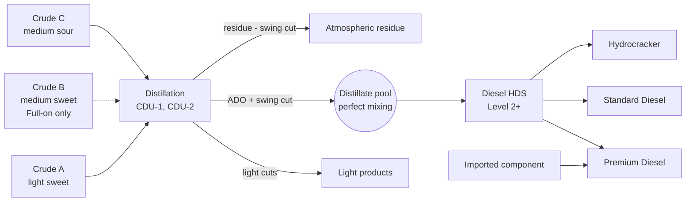

<p align="center">
  
  &emsp;&emsp;&emsp;
  
</p>

# Quantum Madrid Hackathon 2026: Moeve × Classiq Challenge
*"A refinery plan is a long chain of small, connected decisions. Quantum computers will not make that chain simpler, but they may search it differently." (Moeve × Classiq Team)*
<br>

So you fancy taking on the **Moeve × Classiq Refinery Planning** challenge? We welcome you with open arms.<br>

You will plan a small refinery: which crudes to buy, how to set the distillation cut temperatures,
how hard to run a desulphurization unit, and how to split a shared blending tank between products, so that
every product is on spec and the margin is maximal. You will solve it **classically** and with **quantum
algorithms** (QAOA and Grover search) on the Classiq platform, combine **integer and continuous decisions**,
handle a **nonlinear process unit**, and find out what a real planning problem costs on a quantum computer.

The data comes from Moeve's fictional *Refinery Horizon* case, reduced to simulator size. The math is
the same kind: discrete operating decisions on top of **nonconvex pooling** (blend quality = composition × flow)
and a **nonlinear hydrotreater model**.

## At a Glance

| Level | What you do | Instance | Plan qubits | Status |
|---|---|---|---|---|
| **0 · Baselines** | Solve it classically: exact, continuous, heuristic | `easy` | none | Required |
| **1 · Easy** | Solve it with QAOA and/or Grover search | `easy` | 14 | Required |
| **2 · Intermediate** | Add a nonlinear unit (Diesel HDS); fully discrete **or** mixed-integer | `intermediate` | 17 or 11 | Recommended |
| **3 · Full-on** | 3a: a bigger plant. 3b: Moeve's open challenge on their full case | `full_on`, full case | 22 or 16; 3b: your choice | Open |

**Your steps:** set up the Classiq SDK and run `starter.ipynb` ([Working Environment](#working-environment)), work through
the levels in order (a solid Level 1 is worth more than a shaky Level 3), then **explain** where quantum helps, where it
does not, and why. Honest negative results score well. Each level has a **Go further** list of optional extensions at the same difficulty.

**Original ideas and approaches are highly welcome.** Your own formulations, encodings, algorithms or decompositions are welcome at any level, as long as you benchmark them like the rest.

## A Refinery in 60 Seconds
1. A refinery buys **crude oils**. They differ in price, sulphur content and how much diesel they contain.
2. The **distillation column (CDU)** separates each crude by boiling point into cuts: light products, diesel (**ADO**) and heavy residue.
3. The **cut temperature** is a dial. Material near the diesel/residue border (the **swing cut**) goes up into diesel or down into residue. More diesel, but dirtier diesel.
4. Diesel from all crudes is mixed in **one tank (pool)**. Everything leaving the tank has the same quality, so one sour crude spoils all of it.
5. A **hydrotreater (HDS)** removes sulphur from the pool. Harder operation (higher **severity**) removes more, but costs more and loses some product.
6. **Blending** turns the pool (plus a clean imported component) into products that must meet their **specs**. Profit = sales minus crude, import and processing costs.

## The Problem



- **Cut temperature *T*** (345–375 °C) sends a fraction **α = (T − 345)/30** of the 5% **swing cut** up into ADO.
- **Pool:** a perfect mixer, so every outlet has the **same quality**. Quality = composition × flow: this is the hard (bilinear) part.
- **Diesel HDS** (Levels 2 and 3): treats the whole pool, or is bypassed ([model below](#the-diesel-hds-a-nonlinear-conversion-unit-levels-2-and-3)).
- **Margin** = revenue − crude, import, CDU and HDS costs (kEUR).

### Data (flows in kt per 30 days, prices in EUR/t)

| Crude | Price | Available | Light products¹ | ADO core | W_KA² | W_AR (swing) | Residue core | Cetane: ADO core · K/A swing · A/R swing | S% `easy` | S% `intermediate`, `full_on` (Moeve) | CDUs |
|---|---|---|---|---|---|---|---|---|---|---|---|
| A light sweet | 485 | 180 | 0.500 | 0.225 | 0.04 | 0.05 | 0.185 | 54 · 50 · 43 | 0.12 · 0.15 · 0.60 | **0.60 · 1.00 · 5.00** | CDU-1 |
| B medium sweet | 458 | 220 | 0.440 | 0.235 | 0.04 | 0.05 | 0.235 | 52 · 48 · 42 | 0.20 · 0.24 · 0.90 | **1.43 · 1.69 · 5.81** | CDU-1 or CDU-2 |
| C medium sour | 425 | 260 | 0.380 | 0.225 | 0.04 | 0.05 | 0.305 | 49 · 46 · 40 | 0.45 · 0.42 · 1.40 | **5.20 · 6.50 · 14.00** | CDU-1 or CDU-2 |

**Intermediate and Full-on (Levels 2 and 3) are calibrated by Moeve** so that running the HDS hard pays off: the crudes are much more sulphurous there (last S% column), crude C may run on CDU-1 or CDU-2, and CDU-1 is smaller (see below). Cetane, yields and prices are the same in all levels.

¹ Yields are mass fractions of the crude F. Light = (light + ½·W_KA)·F; ADO = (ADO core + ½·W_KA + α·W_AR)·F; residue = (residue core + (1 − α)·W_AR)·F.
² The kerosene/ADO swing is fixed at 50/50.

| Unit | `easy` | `intermediate`, `full_on` (Moeve) |
|---|---|---|
| CDU-1 | capacity 300 kt, 5 EUR/t | capacity **180 kt**, 5 EUR/t |
| CDU-2 | not used | capacity 260 kt, **5.5 EUR/t** |
| Diesel HDS | not used | capacity **90 kt**, cost and sulphur removal per the model below |

| Product | Value | Rule |
|---|---|---|
| Premium Diesel | 700 EUR/t | cetane ≥ 55, sulphur ≤ 0.07%, ≤ 140 kt |
| Standard Diesel | 620 EUR/t | cetane ≥ 49, sulphur ≤ 0.25%, ≤ 180 kt |
| Hydrocracker feed / light products / residue | 500 / 600 / 320 EUR/t | no specs |
| Imported component (buy) | 695 EUR/t | cetane 62, sulphur 0.01%; Premium Diesel only; ≤ 50 kt |

**Rules:** qualities blend linearly by mass (write specs without division: `Σ m·q ≤ q_max·Σ m`), and apply only to products actually produced. Premium Diesel = premium share × pool + import; Standard Diesel = standard share × pool; the rest goes to the hydrocracker. Purchases ≤ availability; each crude runs on one allowed CDU; loads ≤ capacity.

### The Diesel HDS: a nonlinear conversion unit (Levels 2 and 3)
This is the hydrotreater equation from Moeve's case (Appendix B5), applied to the diesel pool. Feed sulphur `S_in`
(mass fraction, 0.5% = 0.005), relative load `L = pool feed / capacity` (must be ≤ 1), severity `z` in [0, 1]:

```
S_out = S_floor(z) + S_in · f_kinetic(z) · f_hydraulic(L, z) · f_inhibition(S_in)
f_kinetic    = 0.028 + 0.22·exp(−4.8 z) + 0.070·(z − 0.64)² + 0.035·(z − 0.64)⁴
f_hydraulic  = 1 + 0.36·L^1.7 + 0.14·L·z + 0.08·(L·z)²
f_inhibition = 1 + 18·S_in^1.25 + 220·S_in²
S_floor      = 0.000012·(1 + 0.30·(1 − z)²)
yield η      = 0.992 − 0.010·z^1.6 − 0.004·L²        (the loss is gas, no value)
cost         = (10 + 8·z^2.2) EUR per tonne of feed;   cetane is unchanged
```

Severity is a decision: **bypass** (unit off, no cost) or z ∈ {0, 0.5, 1}. Note that `f_kinetic` is lowest near
z ≈ 0.64, so more severity is not always better. `refinery.hds_outlet` implements it.

### Decisions and encodings
Every instance comes with two encodings (2 bits per variable unless stated, levels 0 → 3):

| Variable | Levels 0 → 3 | `discrete` | `mixed_integer` |
|---|---|---|---|
| `crude_A`, `crude_B`, `crude_C` | 0/60/120/180 kt, 0/70/140/210 kt, 0/80/160/240 kt | qubits | qubits |
| `cut_temp_A`, `cut_temp_B`, `cut_temp_C` | 345, 355, 365, 375 °C (α = 0, 1/3, 2/3, 1) | qubits | qubits |
| `cdu_C` (Intermediate, Full-on), `cdu_B` (Full-on); 1 bit each | 0 = CDU-1, 1 = CDU-2 | qubits | qubits |
| `hds_severity` (Intermediate, Full-on) | bypass, z = 0, 0.5, 1 | qubits | qubits |
| `premium_share`, `hydrocracker_share` | 0, 1/6, 1/3, 1/2 of the pool (Standard Diesel takes the rest) | qubits | **continuous** in [0, 1] |
| `import` | 0, 15, 30, 45 kt | qubits | **continuous** in [0, 50] |

| Instance | Plant | `discrete` qubits (plans) | `mixed_integer` qubits (operating modes) |
|---|---|---|---|
| `easy` | Crudes A, C · CDU-1 | 14 (16,384) | 8 (256) |
| `intermediate` | Crudes A, C · CDU-1, CDU-2 · Diesel HDS (90 kt), Moeve calibration | 17 (131,072) | 11 (2,048) |
| `full_on` | Crudes A, B, C · CDU-1, CDU-2 · Diesel HDS (90 kt), Moeve calibration | 22 (4,194,304) | 16 (65,536) |

In **mixed-integer** mode, the operating mode (crudes, temperatures, CDUs, severity) is on qubits. Once it is fixed,
the pool's mass and quality are known, so choosing the pool split and import is a small **linear program**.
`refinery.complete_plan` solves it (about 0.5 ms per call). Trading 6 qubits for one LP per sample is the
integer + continuous trade-off you will measure.

## Levels
Every result you report must be checked with `refinery.evaluate` and goes into the [results table](#documentation-requirement); the *Done when* lines assume this.

### Level 0 · Baselines (required, classical)
On `easy`:
- **Exact discrete optimum** by enumeration (16,384 plans, under a second). How many plans are feasible? How many are optimal?
- **Continuous optimum**, your upper bound: run `complete_plan` on every operating mode, then refine crude amounts and cut temperatures continuously (fine grid or an NLP solver; `complete_plan` accepts any `Plan`). Report the **discretization gap** = (continuous − discrete) / continuous.
- **One heuristic** (random search, simulated annealing, ...): how many plan evaluations does it need to find the optimum with ≥ 90% probability (repeat runs)?

**Done when** you have three numbers (discrete optimum, continuous optimum, heuristic evaluations) and a feasibility count. This is the bar the quantum methods are measured against.

**Go further:** discretization gap vs. bits per variable (1, 2, 3 bits); a second heuristic; a plot of the margin landscape.

### Level 1 · Easy (required, quantum)
On `easy`, 14 plan qubits:
- **Encode** a plan as quantum variables (e.g. a `QStruct` of `QNum` levels) and write the margin as a plain-Python function usable both in Qmod and on measured results.
- **Constraints:** gate the cost with `control(...)` on a feasibility check, or use penalties. A straightforward arithmetic implementation of the sulphur specs does **not** fit in 28 qubits; how you encode them is part of the challenge.
- **QAOA:** cost layer `phase(-cost(v), gamma)`, mixer `RX(beta)` on every qubit, parameters tuned in a classical loop (`ExecutionSession`).
- **Grover search for optimization** (Dürr-Høyer): an oracle marking feasible plans with margin above a threshold *T*; raise *T* each time a better plan is found.

Implement at least one of the two; implementing both and comparing them scores higher.

**Benchmark (required).** Same instance, same metrics for every method, classical and quantum:
1. **Queries to the optimum** (found with ≥ 90% probability, over repeated runs): plans evaluated (enumeration, your heuristic), oracle calls (Grover), shots (QAOA: training + final).
2. **Scaling:** repeat at three sizes by fixing variables at level 0: N = 2^10 (fix `import` and `hydrocracker_share`), 2^12 (fix `import`), 2^14 (full). Plot queries vs. N on log-log axes, fit the slope, and compare with theory (N for exhaustive search, √N for Grover; no proven rate for QAOA).
3. **Quality vs. effort:** P(feasible), P(optimal) and gap to the optimum vs. QAOA layers p or Grover iterations.
4. **Resources per size:** width, depth and two-qubit gates from synthesis.

**When is each method relevant?** For QAOA and for Grover search (also the one you did not implement), state briefly: what is proven and what is only measured, what the circuit needs (oracle, depth, number of shots), and on which kind of hardware the method could pay off (today's noisy devices or fault-tolerant machines). Use your scaling plot as evidence.

**Done when** your quantum method returns a feasible plan and the four benchmark items are done for it.

**Go further:** CVaR objective; warm starts and parameter transfer between layers; your Grover iteration schedule vs. Dürr-Høyer theory; alternative near-optimal plans from the final sample.

### Level 2 · Intermediate (recommended)
On `intermediate`: the `easy` crudes on two CDUs, plus the Diesel HDS, with Moeve's calibration (more sulphurous crudes, a smaller CDU-1). The HDS inlet sulphur is not given: it follows from your crudes, cut temperatures and swing-cut routing, so a higher cut temperature gives more diesel but also sends more sulphur to the HDS. Two tracks; do at least one, ideally both and compare.

**How do you put a nonlinear unit into a quantum algorithm?** Three options, each with a cost:
(a) **coherent arithmetic** of exp and fractional powers: exact but far too wide for today's simulators (estimate its resources);
(b) **compile** the equation over its discrete inputs (crudes, temperatures, severity) into a lookup or into feasible "boxes" of plans;
(c) **evaluate it classically** for each sample (hybrid). Say which you chose and what it would cost at scale.

- **2a · Discrete (17 qubits):** severity is one more 2-qubit variable, crude C's CDU one more bit. Run your Level 1 method with the HDS in the cost and the specs.
- **2b · Mixed-integer (11 qubits):** the operating mode on qubits, `complete_plan` for the rest. A loop that scores samples (`ExecutionSession.estimate_cost`) calls it directly; a QAOA phase layer needs a coherent cost, so tabulate the LP value of all 2,048 modes (about a second) and say it is a simulator shortcut. Plan for synthesis time: in our tests one QAOA layer with the tabulated cost was about 9,500 two-qubit gates and took 10 to 20 minutes to synthesize, so synthesize once with parameters and start with p ≤ 2.

**Benchmark.** The Level 1 metrics (queries, quality vs. effort, resources) for each track you run, plus **classical LP calls** for 2b. If you run both tracks, compare them: qubits, classical work, gap to the continuous optimum, and whether they find the same operating mode. Add the Level 2 points to your Level 1 scaling plot.

**Done when** at least one track returns a feasible plan and its benchmark is done.

**Go further:** finer intervals for the continuous variables (3 bits) vs. the LP route: gap vs. qubits; continuous variables as extra classical parameters in the variational loop, optimized together with γ, β; feasibility-preserving mixers; synthesize option (a) for one spec and report width and depth.

### Level 3 · Full-on (open)
**3a · The bigger plant.** On `full_on`: three crudes, two CDUs, the HDS, with Moeve's calibration. The **mixed-integer** encoding (16 qubits) fits the simulator. The **fully discrete** one (22 plan qubits) plus constraint machinery goes beyond what you can train this weekend (in our tests a similar circuit needed about 27 qubits and about 40,000 two-qubit gates and did not finish), so for it report synthesized resources, not runs. **Benchmark:** the Level 1 metrics for what you run, synthesized resources for what you cannot, and a check of whether the measured point follows the slope you fitted at Levels 1 and 2.

**3b · Moeve's open challenge.** An open question from the Moeve team on their full *Refinery Horizon* case (five crudes, three CDUs and VDUs, three pools, conversion units, nine products, all continuous): how would you bring this planning problem, or a meaningful part of it, to a quantum computer? Choose your own scope, formulation and simplifications (for example, discrete cut temperatures and HDS severity with continuous flows, as in Level 2b), explain them, and estimate the resources and when the approach could become relevant. There is no fixed deliverable: we want to see what you come up with.

**Go further:** quantum amplitude estimation of the margin risk of your plan under price uncertainty; a quantum branch-and-bound cost estimate from a classical solver's node count; certifying the global optimum; your own formulation or decomposition.

## Working Environment
This challenge runs on the **Classiq platform** (Python SDK and the Classiq AI tool); registered participants get access for the weekend. Everything runs on simulators, with **no quantum hardware access** required.

**Setup**
1. Python 3.10–3.13, then `pip install classiq numpy scipy pandas matplotlib`.
2. Log in once: `python -c "import classiq; classiq.authenticate()"` and follow the link.
3. Run `starter.ipynb` top to bottom.

**Provided files**

| File | What it is |
|---|---|
| `data/easy.json`, `data/intermediate.json`, `data/full_on.json` | The instances, with both encodings |
| `refinery.py` | The evaluator: `evaluate(instance, plan)` returns margin, flows, qualities and violated constraints; `decode(instance, bits, mode)` turns a bitstring into a plan; `complete_plan(instance, mode)` solves the continuous LP; `hds_outlet(...)` is the HDS model |
| `starter.ipynb` | A tour of the files: plants, encodings, evaluation, HDS, mixed-integer completion, counting evaluations |
| Moeve's full case document | For Level 3b (link to follow) |

**Compute budget.** The Classiq simulators handle **28 qubits in total**, including auxiliary qubits. Measured on the Classiq simulator (1,000 shots per evaluation):

| Run | Time |
|---|---|
| One cost evaluation, shallow circuit, up to 22 qubits | about 2.5 s (mostly overhead) |
| Same at 24 / 26 qubits | about 4 s / 7.5 s |
| One cost evaluation, Level 1 QAOA with constraint gating (18 qubits) | 10–15 s |
| Level 1 QAOA training run (20–40 evaluations) | 4–6 min |
| Level 1 Grover threshold search (one job per step) | about 10 min |
| Synthesis of a Level 1 circuit | under 1 min |
| Classical: `evaluate` / `complete_plan` | about 7 µs / 0.5 ms per call |

Depth and gate count, not width, set the time below about 24 qubits. **Iterate fast:** develop with 100–200 shots and use 1,000+ only for final numbers; tune angles on `easy` and transfer them; precompute classical cost tables for small instances (and say it is a simulator shortcut); plan your Grover thresholds, since each step is a job.

## Documentation Requirement
Your write-up should include your model and encodings, your classical and quantum workflows, the **benchmark outputs** of each level you completed (plots and the when-is-each-method-relevant discussion), what is asymptotic and what is a simulator shortcut (e.g. an oracle built from a precomputed table), and the **results table**, one row per level and method:

| Column | Definition |
|---|---|
| Level, method | e.g. "1, QAOA p=2", "2b, CVaR-VQE + LP" |
| Best plan, feasible | Bitstring and margin (kEUR), checked with `refinery.evaluate` |
| Gap to optimum | (best known optimum − your margin) / best known optimum; say which optimum (discrete or continuous) |
| P(feasible), P(optimal) | Share of feasible and optimal plans in your final sample |
| Queries to solution | Classical: evaluations. Grover: oracle calls. QAOA: training shots + final shots |
| Classical LP calls | Mixed-integer runs only |
| Width / depth / 2-qubit gates | From synthesis (`get_transpiled_circuit_metrics`) |

## Submission
1. Create a team-named folder with all your code (classical and quantum), notebooks and utilities.
2. Include a `README.md` linking to your write-up, or the write-up itself, with the results table.
3. Submit according to the event instructions and deadlines, and give a short final pitch.

Make sure your submission is self-contained and reproducible.

## Evaluation Criteria
1. **Correctness (20%)**: Levels 0 and 1 complete; plans and margins agree with `refinery.evaluate`; results are reproducible.
2. **Quality of Benchmarking (25%)**: the benchmark of each level, done fairly (same instance and metrics for every method, discretization error kept apart from optimization error).
3. **Technical Depth (25%)**: encodings, constraint handling, the nonlinear unit, integer + continuous handling, circuit resources.
4. **Scale & Creativity (15%)**: Levels 2 and 3 (including Moeve's open challenge), Go further items, and original ideas and approaches.
5. **Write-up & Pitch (15%)**: clear, honest, well presented.

Levels 0 and 1 are the entry ticket. What separates teams is the honesty of the comparison and how far the method scales.

## Key Insight
This challenge is **not** about beating industrial solvers: a classical solver handles these plants in seconds. It is about understanding **how operating decisions map to qubits**, **why constraints and nonlinear units are the hard part**, **what continuous variables cost** in a quantum workflow, and **when quantum search reduces the number of queries**, and when that matters.<br>
Good luck, and happy hacking!

## Differences from Moeve's Full Case

| Moeve's *Refinery Horizon* | This challenge |
|---|---|
| 5 crudes, 3 CDUs, 3 VDUs | 2–3 crudes, 1–2 CDUs, no VDUs |
| Swing cuts at 3 boundaries per crude | ADO/Residue boundary only; the other two fixed at 50/50 |
| 3 intermediate pools | 1 distillate pool |
| Kero-HDS on kerosene | Diesel HDS on the distillate pool, same equations |
| Gasoline conversion, hydrocracker, thermal cracker modelled | Fixed netbacks: light products 600, hydrocracker feed 500, residue 320 EUR/t |
| 9 products, min and max sales | 2 diesel grades, max sales only |
| Imported Premium Diesel at 600 EUR/t | 695 EUR/t, so importing is not a free arbitrage against the 700 EUR/t product |
| All decisions continuous | Discrete, or mixed-integer (operating mode discrete, blending continuous) |

## Glossary
**CDU**: crude distillation unit. **ADO**: atmospheric diesel oil, the diesel cut. **Swing cut**: slice at the border of two cuts; the cut temperature decides where it goes. **Sweet / sour**: low / high sulphur. **Cetane**: diesel ignition quality (higher is better). **S**: sulphur, % by mass. **HDS**: hydrodesulphurization unit, removes sulphur with hydrogen. **Severity**: how hard the HDS is run. **Hydrocracker**: unit breaking heavy oil into lighter products; here, the low-value outlet of the pool. **Pooling**: mixing streams in a shared tank before blending. **kt**: 1,000 tonnes.

## Useful Links
- [Classiq QAOA](https://github.com/Classiq/classiq-library/blob/main/algorithms/search_and_optimization/QAOA/qaoa.ipynb): the reference QAOA pattern in Qmod.
- [Algorithm design with Qmod, Part II](https://github.com/Classiq/classiq-library/blob/main/tutorials/workshops/algo_design_QCE_tutorial/algo_design_QCE_tutorial_part_II.ipynb): knapsack with penalties vs. a hard constraint gated with `control`.
- [Grover's search](https://github.com/Classiq/classiq-library/blob/main/algorithms/search_and_optimization/grover/grover.ipynb): includes a threshold oracle for an optimization problem.
- [Grover mixers for QAOA](https://github.com/Classiq/classiq-library/blob/main/algorithms/search_and_optimization/grover_mixer_qaoa/gm_qaoa.ipynb): QAOA that stays in the feasible space.
- [Arithmetic expressions](https://github.com/Classiq/classiq-library/blob/main/tutorials/technology_demonstrations/arithmetic_expressions/arithmetic_expressions.ipynb): how synthesis trades width for depth.
- [Classiq documentation](https://docs.classiq.io/): [`phase`](https://docs.classiq.io/qmod-reference/language-reference/statements/phase), [quantum arithmetic](https://docs.classiq.io/user-guide/modeling/quantum-numbers-arithmetics), [`grover_operator`](https://docs.classiq.io/qmod-reference/library-reference/open-library-functions/grover_operator/grover_operator), [`ExecutionSession`](https://docs.classiq.io/user-guide/execution/ExecutionSession), [synthesis constraints](https://docs.classiq.io/user-guide/synthesis/constraints), [simulator limits](https://docs.classiq.io/user-guide/execution/cloud-providers/classiq-backends#supported-backends).
- [Improved swing-cut modeling](https://elmi.hbku.edu.qa/en/publications/improved-swing-cut-modeling-for-planning-and-scheduling-of-oil-re/) (Menezes, Kelly & Grossmann, 2013): how refineries model swing cuts.
- [Quantum annealing for pooling and blending](https://psecommunity.org/LAPSE:2025.0403) (Mappas et al., 2025): pooling constraints as a QUBO.
- [Quantum-classical crude oil scheduling](https://arxiv.org/abs/2604.26459) (Yang et al., 2026): hybrid decomposition with QAOA.
- [QAOA](https://arxiv.org/abs/1411.4028) (Farhi et al., 2014) and [CVaR for variational optimization](https://arxiv.org/abs/1907.04769) (Barkoutsos et al., 2020).
- [Dürr-Høyer minimum finding](https://arxiv.org/abs/quant-ph/9607014) (1996) and [Grover Adaptive Search](https://arxiv.org/abs/1912.04088) (Gilliam et al., 2021).
- [Quantum branch-and-bound](https://arxiv.org/abs/2210.03210) (Chakrabarti et al., 2022) and [beyond quadratic speedups](https://arxiv.org/abs/2011.04149) (Babbush et al., 2021): why error-correction overhead matters for quadratic speedups.
- Hardware roadmaps, for the when-is-each-method-relevant discussion: [IBM Quantum roadmap](https://www.ibm.com/quantum/technology#roadmap) and its [2025 fault-tolerance announcement](https://thequantuminsider.com/2025/06/10/ibm-offers-roadmap-toward-large-scale-fault-tolerant-quantum-computer/), [Google Quantum AI roadmap](https://quantumai.google/roadmap).
